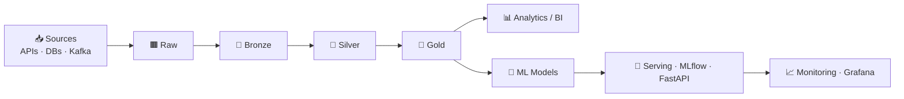

<!-- ═══════════ HEADER ═══════════ -->
<div align="center">


<a href="https://git.io/typing-svg">
  
</a>

<br/>

<a href="https://www.linkedin.com/in/renan-toyoyama-3b0165308/"></a>
<a href="mailto:renantoyoyama@gmail.com"></a>
<a href="https://www.instagram.com/barista_toyao_/"></a>
<a href="https://www.facebook.com/renan.toyoyama?locale=pt_BR"></a>


</div>

---

## 👨‍💻 About me

```python
class Renan:
    """Data Engineer & Data Scientist, powered by coffee."""

    def __init__(self) -> None:
        self.role: list[str] = ["Data Engineer", "Data Scientist", "ML Engineer"]
        self.creating_bugs_since: int = 2018
        self.currently_learning: list[str] = ["Machine Learning", "MLOps", "日本語"]
        self.goals: list[str] = [
            "Provide a great life for my daughters 👨‍👧‍👧",
            "Work with data in Japan 🇯🇵",
        ]
        self.fun_fact: str = "Barista ☕ — I make great lattes with latte art"
        self.architecture: str = "raw → bronze → silver → gold"
```

- 🔭 Building end-to-end **data pipelines** and **ML systems** from ingestion to production
- 🌱 Diving deep into **Machine Learning, MLOps** and **Japanese** (勉強中！)
- 🎯 Goal: become a data professional in **Japan** 🗾
- ☕ Fun fact: I'm a **barista** — ask me about latte art

---

## 🛠️ Tech Stack

### 🐍 Languages & Core


### 🏗️ Data Engineering


### 📊 Data Science & Analytics


### 🤖 Machine Learning & ML Engineering


### 🔁 MLOps


### ☁️ Cloud, DevOps & GitOps


### 🧰 Tools


---

## 🔄 How I build data



---

## 📈 GitHub Stats

<div align="center">


</div>

---

<div align="center">

### ☕ *"Good data, like good coffee, needs the right extraction."*

**よろしくお願いします！** 🇯🇵


</div>
